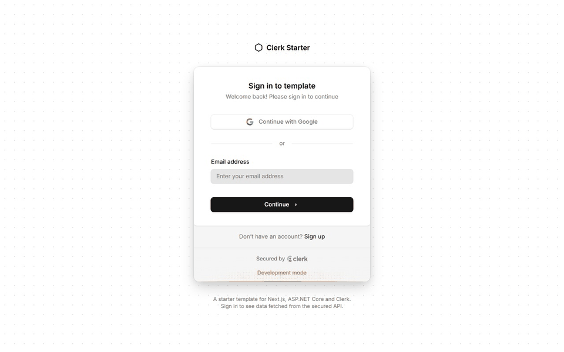
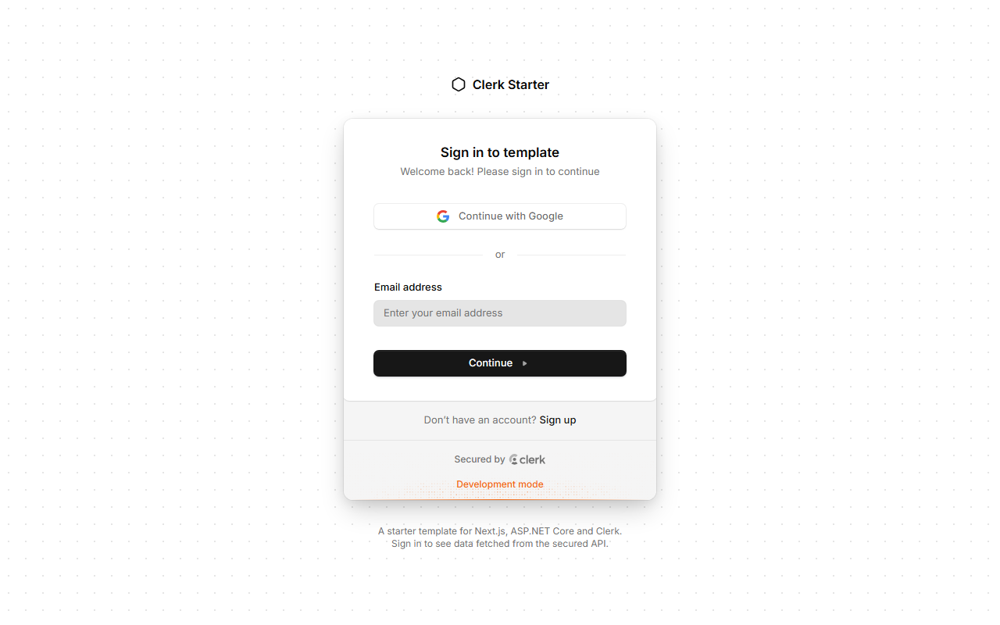
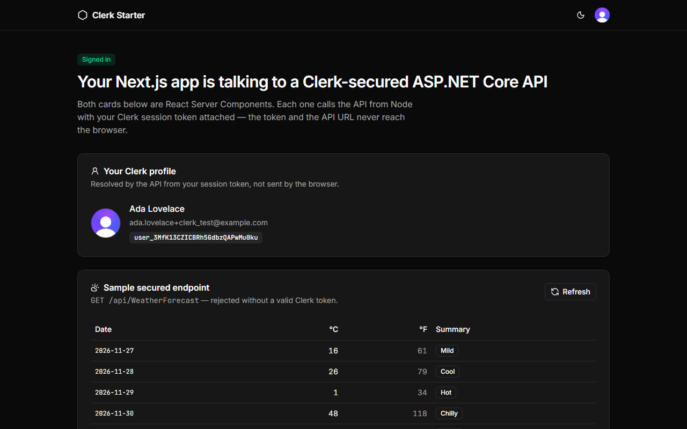
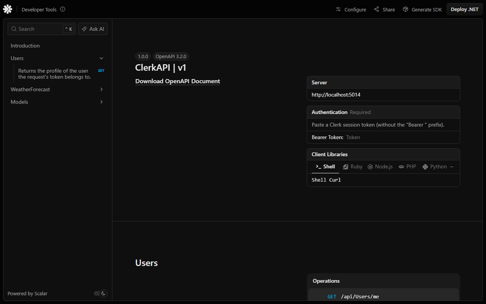

# Next.js + ASP.NET Core + Clerk

[](https://github.com/HilthonTT/nextjs-aspnetcore-clerk-starter/actions/workflows/ci.yml)
[](https://dotnet.microsoft.com/download)
[](https://nextjs.org)
[](LICENSE)

A starter template for a **Next.js** frontend calling an **ASP.NET Core Web API** secured with
**Clerk**. The frontend signs users in and forwards their session token server-side; the API
validates it as a JWT against your Clerk instance.

**[Use this template →](https://github.com/HilthonTT/nextjs-aspnetcore-clerk-starter/generate)**



| Sign in                                 | Dashboard (dark)                                       | API reference (Scalar)                            |
| --------------------------------------- | ------------------------------------------------------ | ------------------------------------------------- |
|  |  |  |

## What you get

- **Next.js 16**: App Router, React 19, Tailwind v4, shadcn/ui, dark mode, streaming server components
- **ASP.NET Core 11**: controllers, OpenAPI + [Scalar](https://scalar.com), health checks, RFC 9457 problem details
- **Clerk on both sides**: hosted sign-in/up, JWT bearer validation with an `azp` check, secure-by-default authorization
- **Fail-fast config**: the API refuses to start when Clerk settings are missing
- **Tests and CI**: xUnit v3 auth-surface tests (no Clerk account needed), warnings-as-errors, NuGet audit,
  `dotnet format` check, Docker image build, Dependabot

The .NET side uses [Clerk.Net](https://github.com/Hawxy/Clerk.Net).

## Quick start

You need the [.NET 11 SDK](https://dotnet.microsoft.com/download), [Node.js 24](https://nodejs.org)
(20.9+ works), and a free [Clerk](https://clerk.com) app. Grab its **publishable key**, **secret key**,
and **Frontend API URL** from **API Keys** in the [dashboard](https://dashboard.clerk.com).

```bash
# 1. API: http://localhost:5014 (API reference at /scalar)
cd Backend/ClerkAPI
dotnet user-secrets set "Clerk:SecretKey" "sk_test_..."
dotnet user-secrets set "Clerk:Authority" "https://verb-noun-00.clerk.accounts.dev"
dotnet run

# 2. Frontend: http://localhost:3000
cd Frontend/web
cp .env.example .env.local   # fill in your Clerk keys
npm install && npm run dev

# 3. Checks
cd Backend && dotnet test CsharpAPIClerk.slnx
cd Frontend/web && npm run lint && npm run typecheck && npm run build
```

## How it works

```
Browser ──Clerk session──▶ Next.js server component ──Bearer <token>──▶ ASP.NET Core API ──▶ Clerk Backend API
```

1. `proxy.ts` (Clerk middleware) protects every route except `/sign-in` and `/sign-up`.
2. Server components call `apiFetch` (`lib/api.ts`), which attaches `(await auth()).getToken()`.
   The token and `API_URL` never reach the browser.
3. The API checks the signature against Clerk's JWKS (`Clerk:Authority`) and rejects tokens whose `azp`
   is not `Clerk:AuthorizedParty`. A fallback policy means **every endpoint requires auth** unless
   marked `[AllowAnonymous]`.
4. `User.GetUserId()` returns the Clerk user id; `UsersController` uses it to fetch the profile.

| Method | Route                  | Auth | Description                         |
| ------ | ---------------------- | ---- | ----------------------------------- |
| GET    | `/health`              | no   | Liveness probe                      |
| GET    | `/api/WeatherForecast` | yes  | Sample data                         |
| GET    | `/api/Users/me`        | yes  | Clerk profile behind the token      |
| GET    | `/openapi/v1.json`     | no   | OpenAPI document (development only) |
| GET    | `/scalar`              | no   | API reference UI (development only) |

## Configuration

| Setting (backend `appsettings.json` / env `Clerk__SecretKey`) | Required | Description                                          |
| ------------------------------------------------------------- | -------- | ---------------------------------------------------- |
| `Clerk:SecretKey`                                             | yes      | `sk_...`. Use user-secrets or an env var             |
| `Clerk:Authority`                                             | yes      | Clerk Frontend API URL, used for JWKS                |
| `Clerk:AuthorizedParty`                                       | yes      | Frontend base URL, checked against `azp`             |
| `Cors:AllowedOrigins`                                         | no       | Only if a browser calls the API directly             |

| Variable (frontend `.env.local`)    | Required | Description                                          |
| ----------------------------------- | -------- | ---------------------------------------------------- |
| `NEXT_PUBLIC_CLERK_PUBLISHABLE_KEY` | yes      | `pk_...`                                             |
| `CLERK_SECRET_KEY`                  | yes      | `sk_...`, server-side only                           |
| `API_URL`                           | yes      | API base URL. No `NEXT_PUBLIC_`: server-side only    |
| `NEXT_PUBLIC_CLERK_SIGN_IN_URL/_UP_URL` | no   | Default `/sign-in`, `/sign-up`                       |

> **Why `API_URL` is HTTP locally:** the call is server-to-server from Node, which doesn't trust the
> ASP.NET dev certificate (`DEPTH_ZERO_SELF_SIGNED_CERT`), so HTTPS redirection is only enabled outside
> Development. For local HTTPS, run `dotnet dev-certs https --trust`, start Next with
> `node --use-system-ca ./node_modules/next/dist/bin/next dev`, and set `API_URL=https://localhost:7080`.

## Make it yours

1. **Rename** `CsharpAPIClerk.slnx`, `ClerkAPI/`, and the `ClerkAPI` namespace (find-and-replace in `Backend/`).
2. **New user-secrets id:** delete `<UserSecretsId>` from `ClerkAPI.csproj`, then `dotnet user-secrets init`.
3. **Delete the sample:** `WeatherForecastController`, `Models/WeatherForecast.cs`, its type in
   `types/api.ts`, and `ForecastCard`.
4. **Set production origins:** `Clerk:AuthorizedParty`, and `Cors:AllowedOrigins` if needed.
5. **Replace metadata:** title in `app/layout.tsx`, contact in `SECURITY.md`, this README.

**Adding an endpoint:** add a controller under `Controllers/` (auth is on by default), its model under
`Models/`, the route to `AuthorizationTests`, a mirror type in `types/api.ts`, then call
`apiFetch<T>("/api/...")` from a server component wrapped in its own `<Suspense>`.

## Deploying

`Backend/Dockerfile` builds a non-root Alpine image listening on 8080. Build **from the repo root**:

```bash
docker build -t clerkapi -f Backend/Dockerfile .
docker run --rm -p 8080:8080 -e Clerk__SecretKey=sk_live_... \
  -e Clerk__Authority=https://clerk.example.com -e Clerk__AuthorizedParty=https://app.example.com clerkapi
```

CI publishes it to `ghcr.io/<owner>/<repo>/api` on pushes to `main`. In production, use your Clerk
**production** keys, set `AuthorizedParty` to the deployed frontend URL, point `API_URL` at the
deployed API, and probe `/health`. `ASPNETCORE_ENVIRONMENT=Production` (the image default) turns on
HTTPS redirection + HSTS and hides `/scalar` and `/openapi`.

## Troubleshooting

| Symptom                                       | Likely cause                                                                     |
| --------------------------------------------- | -------------------------------------------------------------------------------- |
| `OptionsValidationException` at startup       | A `Clerk:*` setting is missing; the message names it                             |
| `401` · `AZP claim is invalid or missing`     | `Clerk:AuthorizedParty` ≠ frontend base URL (check `http` vs `https`)            |
| `401` on every request                        | `Clerk:Authority` points at another instance than the frontend's keys            |
| "Could not reach the API" card                | API not running, or `API_URL` has the wrong port                                 |
| `DEPTH_ZERO_SELF_SIGNED_CERT`                 | `API_URL` uses HTTPS; use `http://localhost:5014` (see above)                    |
| `dotnet test` complains about VSTest          | Run it from `Backend/`, where `global.json` selects Microsoft.Testing.Platform   |
| `NU1903` warning                              | A new advisory; bump the package in `Directory.Packages.props`                   |

Versions live in `Backend/Directory.Packages.props` (NuGet) and `Frontend/web/package.json` (npm);
Dependabot opens grouped weekly PRs. More frontend detail is in [`Frontend/web/README.md`](Frontend/web/README.md).

## Contributing

See [CONTRIBUTING.md](CONTRIBUTING.md). Report security issues via [SECURITY.md](SECURITY.md).

## License

[MIT](LICENSE)
